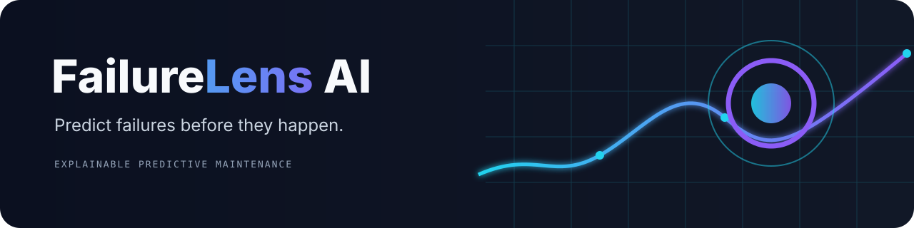
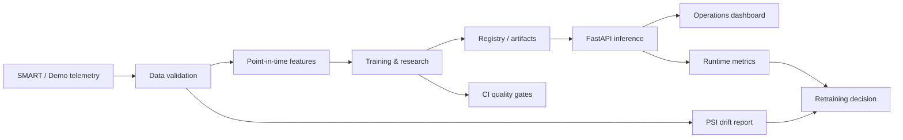

<p align="center"></p>

<p align="center">
  <a href="https://github.com/SergeysYar/FailureLens-AI/actions/workflows/ci.yml"></a>
  
  
  
  
</p>

# FailureLens AI

**Predict failures before they happen.**

Explainable machine learning for predictive equipment maintenance. FailureLens AI turns historical SMART telemetry into point-in-time failure-risk signals, research reports, model explanations, and an operational API.

> **Portfolio status:** runnable engineering MVP with research and MLOps foundations. The included dashboard uses deterministic synthetic data. Synthetic metrics are never presented as real-world performance.

## Contents

- [Product overview](#product-overview)
- [Quick start](#quick-start)
- [Research protocol](#research-protocol)
- [Production MLOps](#production-mlops)
- [Architecture](#architecture)
- [API](#api)
- [Reproducibility](#reproducibility)
- [Limitations](#limitations)
- [Public release checklist](#public-release-checklist)

## Product overview

FailureLens is designed around a practical maintenance workflow:

1. validate telemetry and device-date uniqueness;
2. compute only features available at prediction time;
3. forecast registered failures over 7- or 30-day horizons;
4. compare baselines under chronological validation;
5. expose risk and signed feature contributions through FastAPI;
6. monitor serving health, latency, risk distribution, model versions, and feature drift.

The web application is a dark, responsive operations dashboard with real API-backed states. It includes fleet overview, device search, research leaderboard, registry status, monitoring, and explicit DEMO / SYNTHETIC labeling.

## Quick start

```bash
python -m venv .venv
.\.venv\Scripts\Activate.ps1       # Windows PowerShell
pip install -e ".[dev]"

make demo
make train
make research-quick
uvicorn failurelens.api:app --reload
```

Open `web/index.html` for the static dashboard and `http://127.0.0.1:8000/docs` for interactive API docs. The dashboard expects the API at `http://127.0.0.1:8000`.

For the container path:

```bash
docker compose up --build
# API: http://127.0.0.1:8000
# Dashboard: http://127.0.0.1:3000
```

The development Compose profile bootstraps the small demo only when `FAILURELENS_BOOTSTRAP_DEMO=1`. Production deployments should mount approved artifacts and set it to `0`.

## Research protocol

The research pipeline includes:

- temporal windows of 3, 7, 14, and 30 observations;
- current-state, historical-statistics, temporal-trend, degradation, and metadata feature groups;
- censoring-aware forward labels;
- chronological 60/20/20 splits;
- DummyClassifier, Logistic Regression, Random Forest, and optional CatBoost;
- PR-AUC, ROC-AUC, Brier score, recall, alert-budget recall, and bootstrap intervals;
- feature ablation and operational backtesting;
- dependency-free Kaplan–Meier survival analysis.

```bash
make research-quick
make research-full
make evaluate
make backtest
```

Generated research outputs are written to `artifacts/research/` and intentionally ignored by Git. See [docs/research.md](docs/research.md).

## Production MLOps

The lifecycle is explicit:

```text
validate → features → train → evaluate → register candidate
        → explicit promotion → serve → monitor → drift review → retrain
```

Implemented operational pieces include horizon-specific model loading, local registry states, promotion/rollback commands, readiness/liveness, batch inference, Prometheus-style metrics, request correlation logs, PSI drift reports, non-root Docker runtime, and CI smoke checks.

```bash
make data-validate
make retrain
make register-model
make promote-model VERSION=<version>
make monitor-drift
```

MLflow is an optional Compose tracking profile. Without it, the repository uses a deterministic JSON registry fallback and clearly reports that state. See [docs/mlops.md](docs/mlops.md) and [docs/security.md](docs/security.md).

## Architecture



The implementation deliberately keeps research, serving, registry, and monitoring as importable modules rather than adding a microservice for every box.

## API

| Method | Endpoint | Purpose |
|---|---|---|
| GET | `/health/live` | Process liveness |
| GET | `/health/ready` | Model readiness |
| GET | `/api/v1/summary` | Fleet summary |
| GET | `/api/v1/devices` | Device inventory |
| GET | `/api/v1/devices/{device_id}` | Recent device telemetry |
| POST | `/api/v1/predict` | One-device prediction |
| POST | `/api/v1/predict/batch` | Batch predictions, max 1000 |
| GET | `/api/v1/model/status` | Artifact readiness |
| GET | `/api/v1/model/versions` | Registry records |
| GET | `/api/v1/monitoring/status` | Runtime snapshot |
| GET | `/metrics` | Prometheus-style metrics |

## Reproducibility

```bash
make test
make lint
make demo
make data-validate
make research-full
make benchmark
```

Seeds, dataset fingerprints, feature schema versions, split protocol, and git commit are recorded in research reports. Large raw datasets, credentials, local databases, generated model binaries, and generated reports are excluded from Git.

## Limitations

- The bundled data is synthetic and cannot validate real operational performance.
- The Backblaze source is observational, sparse, and subject to device/model availability bias.
- CatBoost is optional; LightGBM, GRU/TCN, Cox survival, Optuna, MLflow, SHAP, and plotting integrations are not guaranteed to be installed.
- Local registry is a fallback, not a substitute for a managed registry in production.
- Browser E2E, Docker build, load testing, and Lighthouse results must be run in their target environments.
- Risk explanations are model associations, not causal failure diagnoses.

## Roadmap

1. Add a real Backblaze ingestion command with schema manifests.
2. Add managed MLflow tracking and artifact storage.
3. Add delayed-label quality monitoring and alert suppression policy.
4. Add a production frontend build with typed API client and chart library.
5. Validate calibration and alert economics on a site-specific dataset.

## Data source and license

The intended real source is [Backblaze Drive Stats](https://www.backblaze.com/cloud-storage/resources/hard-drive-test-data). See [docs/dataset.md](docs/dataset.md) for attribution and limitations.

Released under the [MIT License](LICENSE).

## Public release checklist

See [docs/public-release.md](docs/public-release.md) for the recommended GitHub About description, topics, social preview asset, and an honest guided demo script.
