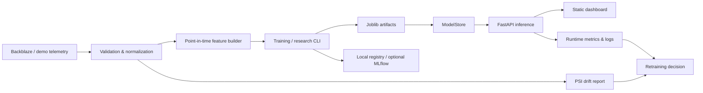

# System architecture

## Boundaries

- `demo.py`: deterministic local data only.
- `features.py`: normalization, point-in-time features, supervised eligibility, and feature groups.
- `model.py`: horizon-specific Logistic Regression training and artifact writing.
- `research.py`: comparison, ablation, bootstrap intervals, backtest, and report generation.
- `survival.py`: dependency-free Kaplan–Meier summary with right censoring.
- `serving.py`: validated, modification-time-cached model loading.
- `registry.py`: explicit local lifecycle states and rollback target selection.
- `monitoring.py`: runtime counters, latency summary, and PSI drift calculations.
- `api.py`: HTTP contract, error handling, health, inference, registry read views, and metrics.
- `web/index.html`: static responsive dashboard consuming the API.

The API is stateless for the demo. PostgreSQL is provisioned by Compose for deployment evolution, but the current Python MVP does not yet persist application records in it. MLflow is an optional tracking profile; JSON is the documented fallback.
